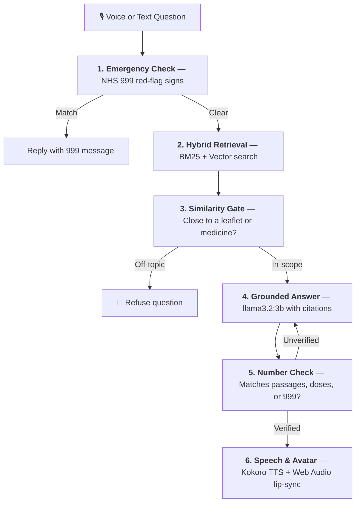

<div align="center">
  

  <p>
    <strong>A voice-first companion that answers questions about your medicines from 12 NHS leaflets, and refuses everything else.</strong>
  </p>

  <p>
    <em>COMP4431 Artificial Intelligence — Group Project</em><br />
    A domain-specific healthcare chatbot in English that runs completely offline on a laptop with a local language model, local speech recognition, and local speech synthesis.
  </p>

  <p>
    
    
    
    
    
  </p>

  <p>
    <a href="#team">Team</a> •
    <a href="#features">Features</a> •
    <a href="#how-an-answer-is-made">Pipeline</a> •
    <a href="#getting-started">Getting Started</a> •
    <a href="#testing-and-evaluation">Testing</a> •
    <a href="#results">Results</a> •
    <a href="#hosting-it-with-your-own-leaflets">Custom Leaflets</a> •
    <a href="#project-structure">Structure</a>
  </p>
</div>

> [!IMPORTANT]
> **Medical Disclaimer:** MedMate is not medical advice. It answers only from the leaflets in `data/leaflets/`, refers people to a pharmacist, and replies with the **999** message when a question describes an emergency.

---

## Contents

- [Team](#team)
- [Features](#features)
- [How an Answer Is Made](#how-an-answer-is-made)
- [Getting Started](#getting-started)
- [Testing and Evaluation](#testing-and-evaluation)
- [Results](#results)
- [Hosting It with Your Own Leaflets](#hosting-it-with-your-own-leaflets)
- [Project Structure](#project-structure)
- [Content and Licence](#content-and-licence)

---

## Team

| Name | Student ID |
| :--- | :--- |
| **Karin Ishikawa** | `23031369D` |
| **Sela De Jong** | `26012648X` |
| **Katina Casimaty** | `26012457X` |
| **Ersan Eke** | `26012487X` |

---

## Features

### Basic

MedMate is a single-page web app with two top-level views—**MedMate** (ask a question) and **My medicines** (personal medicine list)—plus a menu for **Your NHS leaflets** (a built-in viewer for all 12 leaflets), text sizing (**A+**), and **Reset chat**. Terms are defined in [`GLOSSARY.md`](GLOSSARY.md).

#### Supported NHS Medicines (12)

| | | | |
| :--- | :--- | :--- | :--- |
| • Amlodipine | • Atorvastatin | • Levothyroxine | • Paracetamol |
| • Aspirin | • Ibuprofen | • Metformin | • Ramipril |
| • Salbutamol | • Sertraline | • Omeprazole | • Warfarin |

#### 1. Ask View (`MedMate`)

- **Avatar & status pill:** Displays a portrait on the left with live state feedback (*Ready to listen*, *Listening*, *Thinking*, or *Speaking*).
- **Voice or text input:** Tap the microphone (or press `Space`) to speak and tap again to send; MedMate transcribes locally, repeats what it heard (*"You asked about …"*), and prompts you to type if speech is unclear. First-time users can also pick from three one-tap example questions (e.g., *"When should I take metformin?"*).
- **Structured reply cards:** Every answer uses plain language in **at most four sentences**, followed by four scannable sections:
  - **Summary:** One-sentence takeaway.
  - **What to do:** Short list of actionable steps.
  - **Get help if:** Warning signs from the leaflet indicating when to contact a pharmacist, GP, or **999**.
  - **From the NHS leaflets:** Direct links to the cited leaflet passages.
- **Spoken playback:** Answers are read aloud by the avatar as they appear, with a **Read aloud** button on each card to replay.

#### 2. Scope & Safety Guardrails

| What MedMate Answers | What MedMate Refuses / Protects Against |
| :--- | :--- |
| • How and when to take a medicine, using only doses stated in the leaflets | • **Not in the leaflets:** *"I don't have that in my leaflets. Please ask your pharmacist."* |
| • Side effects and what to do if a symptom occurs | • **Off-topic questions:** *"I can only help with questions about your medicines."* |
| • Food, alcohol, and medicine-pair interactions explicitly documented in the leaflets (refers to a pharmacist otherwise) | • **Emergencies (e.g., chest pain, stroke signs):** *"This could be serious. Please call 999 now, or go to A&E."* |
| • Questions involving medicines saved on your personal list | • **No invented numbers:** Never generates a dose not grounded in the cited passages or your own list |

#### 3. Personal List (`My medicines`)

- **Local medicine tracker:** Add any of the 12 medicines with your dose (e.g., `"5 mg"`), schedule times (*morning*, *midday*, *evening*, *bedtime*), and an optional note. Saved locally in the browser in alphabetical order with **Edit**, **Remove**, and a **6-second Undo** option.
- **Today schedule:** Four time-of-day cards (*Morning*, *Midday*, *Evening*, *Bedtime*) with checkable dose boxes that persist for the current day.
- **Interaction banners:** Automatically displays a warning banner with a leaflet link above your list if two saved medicines conflict in an NHS leaflet.
- **Context-aware answers:** Uses your saved list during Q&A—if you ask about one medicine that interacts with another you take, MedMate flags *"You also take …"* alongside the leaflet warning.

---

### Additional

| Feature | What it does | Where |
| :--- | :--- | :--- |
| **Voice recognition** | Tap-to-talk (or `Space`) input transcribed locally via `faster-whisper` (`small.en`) | `backend/speech.py`, `web/js/voice.js` |
| **Voice synthesis** | Spoken replies via **Kokoro** (falls back to macOS `say` if Kokoro is missing, or captions only if both are unavailable) | `backend/speech.py` |
| **2D lip-sync avatar** | Four-frame portrait whose mouth tracks audio volume via a Web Audio analyser and blinks naturally | `web/avatar/`, `web/js/avatar.js`, `prompts/avatar.txt` |
| **Accessible web UI** | Two-view interface with structured reply cards, local medicine schedule, NHS leaflet viewer, `A+` text sizing (`20`, `24`, or `28 px`), and keyboard-only navigation | `web/` |
| **Grounded retrieval** | Hybrid retrieval (**BM25 + vector search**) over the leaflets, paired with a similarity gate that refuses off-topic questions before the LLM runs | `backend/retrieval.py`, `backend/kb.py` |
| **Multi-layer safety** | NHS 999 emergency check, numeric verification on doses, and a validated interaction table for medicine pairs | `backend/safety.py`, `backend/pipeline.py`, `data/interactions.csv` |
| **Local LLM** | `llama3.2:3b` via Ollama with prompts in `prompts/` (not fine-tuned; chosen over `llama3.1:8b` and `qwen2.5:7b` in evaluation) | `backend/llm.py`, `eval/` |

---

## How an Answer Is Made



1. **Emergency check.** Matches fixed phrases for each NHS 999 sign, then asks the model (`yes`/`no`) for each sign. Any match immediately returns the 999 message. The fixed phrases are English only; a question in another language relies on the model check.
2. **Retrieval.** Hybrid BM25 and vector search select the most relevant leaflet passages.
3. **Similarity gate.** If no leaflet passage is close enough and the question is not about a leaflet medicine, MedMate refuses before calling the generator.
4. **Answer.** The model generates a response strictly from those passages and cites them.
5. **Number check.** Any answer containing a number not found in the cited passages, the user's own doses, or the emergency number (`999`) is sent back to the model for correction.
6. **Speech.** The verified reply is spoken aloud while the avatar's mouth tracks the audio output.

---

## Getting Started

### Requirements

- **macOS** — the tested platform (the `say` fallback and Homebrew commands below are macOS-only)
- **[uv](https://docs.astral.sh/uv/)** — installs Python 3.12 and project dependencies (`FastAPI`, `uvicorn`, `faster-whisper`, `Kokoro`, etc.) from `pyproject.toml` and `uv.lock`
- **[Ollama](https://ollama.com/)** — running as a local background service
- **`espeak-ng`** — used by Kokoro for words missing from its dictionary (such as medicine names; without it, those words are skipped in speech)
- **Google Chrome** — with microphone permission enabled
- **Node.js** — required only for the `preflight` web logic checks
- **Internet connection** — needed once to download the models

> [!NOTE]
> **Reference Hardware:** Tested on a MacBook with **Apple M4**, **24 GB memory**, **macOS 27.2.1**, **Python 3.12**, **uv 0.13.7**, **Ollama 0.40.16**, and **Node 24**. All latencies reported below are from this machine; a slower laptop will take longer.

### One-Time Setup

The repository/archive includes the source code, the 12 leaflets, and the pre-built search index (`data/index/`). Download the runtime tools and models once:

1. **Install system tools and start Ollama:**
   ```bash
   brew install uv ollama espeak-ng
   brew services start ollama
   ```

2. **Pull the chat and embedding models:**
   ```bash
   ollama pull llama3.2:3b
   ollama pull nomic-embed-text
   ```

3. **Install the Python environment:**
   ```bash
   uv sync
   ```

4. **Fetch the local speech models (Whisper and Kokoro):**
   ```bash
   uv run python -m scripts.fetch_models
   ```
   *After this step, MedMate runs completely offline.*

### Run the App

```bash
uv run uvicorn --factory backend.app:default_app
```

Open **<http://127.0.0.1:8000>** in Chrome and allow microphone access.

---

## Testing and Evaluation

None of the commands below are needed to run the application.

| Command | What it checks | Prerequisites |
| :--- | :--- | :--- |
| `uv run pytest` | Runs **499 fast unit tests** (~5 s) covering API endpoints, leaflet indexing/retrieval, emergency phrases, prompt building, answer validation, speech text, evaluation metrics, and data files using stand-in models | `uv sync` only |
| `uv run python -m scripts.preflight` | Runs demo-morning release gates with Hugging Face offline: verifies both Ollama models, runs all Python tests (including **12 integration tests** calling real models for the demo script, spoken emergencies, and first-answer latency), and runs web logic tests (`PASS` / `FAIL`) | Ollama running, models fetched, Node.js |
| `uv run python -m eval.run_eval --model llama3.2:3b` | Evaluates the **47 benchmark questions** end-to-end with the real model and writes recall, refusal, answer rate, citation validity, and latency tables to `eval/results/` | Ollama running |

> [!TIP]
> Before rerunning an evaluation, unload any other active Ollama models (`ollama ps`, then `ollama stop <model>`) so latency measurements remain comparable.

---

## Results

### End-to-End Performance (`llama3.2:3b`)

Evaluated on the **frozen final set** (165 questions: 127 single questions and 38 chat turns, `final-llama3.2-3b-report.md`) on the Apple M4 reference laptop:

| Measure | Result | Note |
| :--- | :---: | :--- |
| **Retrieval hit@4 (hybrid)** | **0.91** | On the 77 single answerable questions |
| **Red-flag recall** | **0.92** | 68 of 74 emergencies got the `999` message |
| **Red-flag false alarms** | **0.04** | 6 of 165 rows got the `999` message when not expected (2%–8%) |
| **Refusal rate** | **0.75** | Out-of-scope questions correctly refused (not covered and off-topic) |
| **Answer rate** | **0.79** | Answerable questions that received a real answer |
| **Faithful answers** | **0.22–0.54** | Share of 78 graded answers scoring 3 of 3, by four graders (friend 1: 0.35, friend 2: 0.31 on 26, friend 3: 0.54, Claude: 0.22) |
| **Citation validity** | **0.99** | Cited passage IDs verified against the index |
| **Latency (`p50` / `p95`)** | **9.3 s / 13.6 s** | End-to-end on Apple M4 (24 GB) |

> [!NOTE]
> The final set was frozen before the run and includes multi-turn chats. The earlier 47-question development numbers (recall `1.00`, refusal `1.00`, answer rate `0.81`, `p50` / `p95` `8.2 s / 12.5 s`) were measured on questions the rules were tuned on, so they are higher.

### Model Selection Comparison

Models were evaluated on the same 47-question set under strict selection criteria: **red-flag recall = `1.00`**, **refusal = `1.00`**, and **`p95` latency < `15 s`**, ranked next by highest answer rate and lowest `p95`:

| Model | Red-flag recall | Refusal | Answer rate | `p95` Latency | Verdict |
| :--- | :---: | :---: | :---: | :---: | :--- |
| **`llama3.2:3b`** | **1.00** | **1.00** | **0.81** | **12.5 s** | **Chosen** |
| `llama3.1:8b` | 1.00 | 1.00 | 0.85 | 30.9 s | Too slow (`p95 > 15 s`) |
| `qwen2.5:7b` | 1.00 | 0.86 | 0.85 | 24.7 s | Too slow & refusal `< 1.00` |

*Full benchmark tables are in [`eval/results/summary.md`](eval/results/summary.md), design iterations in [`eval/decisions.md`](eval/decisions.md), and engineering issues encountered in [`CHALLENGES.md`](CHALLENGES.md).*

---

## Hosting It with Your Own Leaflets

The knowledge base lives in `data/leaflets/`. To add or swap medicines:

1. Save the new leaflet as a Markdown file in `data/leaflets/` matching the layout of the existing files.
2. Add any medicine pairs it warns about to `data/interactions.csv`.
3. Rebuild the search index *(requires `nomic-embed-text` in Ollama)*:
   ```bash
   uv run python -m scripts.ingest
   ```
4. Restart the server. At startup, MedMate validates `data/interactions.csv` against the search index and halts if any row cites a missing passage.

*The committed `data/index/` was built from the 12 default NHS leaflets.*

---

## Project Structure

```text
medmate/
├── backend/                # FastAPI server and core pipeline
│   ├── app.py              # Routes and startup validation
│   ├── pipeline.py         # 6-step answer orchestration
│   ├── retrieval.py        # BM25 + vector search and similarity gate
│   ├── kb.py               # Leaflet chunks, index, and interaction table
│   ├── llm.py              # Ollama client and numeric answer validation
│   ├── messages.py         # Prompt assembly and standard reply text
│   ├── safety.py           # NHS 999 emergency detection
│   └── speech.py           # Whisper STT, Kokoro TTS, and macOS say fallback
├── web/                    # Chrome frontend
│   ├── index.html
│   ├── css/
│   ├── js/                 # Chat, voice input, avatar lip-sync, medicines, leaflets
│   ├── avatar/             # Four portrait animation frames
│   └── fonts/
├── data/                   # Knowledge base
│   ├── leaflets/           # 12 NHS medicine leaflets (Markdown)
│   ├── interactions.csv    # Checked medicine interaction pairs
│   └── index/              # Pre-built hybrid search index
├── prompts/                # LLM system prompts and avatar prompts
├── eval/                   # Evaluation questions, metrics, and runner
│   ├── results/            # summary.md and per-run result tables
│   └── decisions.md        # Changelog of experiments and metric deltas
├── scripts/                # fetch_models, ingest, preflight, package.sh
├── tests/                  # Pytest unit and integration suite
├── GLOSSARY.md             # Project terminology
├── CHALLENGES.md           # Problems encountered and how they were resolved
└── pyproject.toml          # Python dependencies (locked via uv.lock)
```

*Run `scripts/package.sh` to build `medmate.zip` from the latest commit.*

---

## Content and Licence

The medicine leaflets are NHS website pages licensed under the **[Open Government Licence v3.0](https://www.nationalarchives.gov.uk/doc/open-government-licence/version/3/)**, collected on **2026-11-15**. In accordance with NHS content reuse terms, leaflets should be refreshed at least every **7 days**—re-collect them if more than 7 days have passed.
